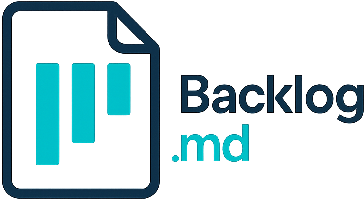
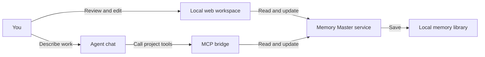

<p align="center">
  
</p>

<h1 align="center">Memory Master</h1>

<p align="center"><strong>Keep a project moving across people and AI agents.</strong></p>
<p align="center">Review progress in a local web workspace. Work in your agent chat. Share project records stored on your machine.</p>
<p align="center"><a href="README.md">简体中文</a> · English</p>

Memory Master is a local tool for project management and handoff. It stores project background, lasting agreements, goals, current progress, tasks, and resources so you can find where work stopped and what comes next when you start a new chat or switch agents.

Use it for software development, learning plans, events, creative work, or research. Each project has its own memory directory and can optionally reference a working folder.

[Quick start](#quick-start) · [Connect an agent](#connect-an-agent) · [Everyday use](#everyday-use) · [Data storage](#data-storage) · [Local development](#local-development)

## Features

| Capability | What you can do |
| --- | --- |
| Multi-project memory library | Create, switch between, and manage projects in one local web workspace, with separate records for each project. |
| Project overview | Read current progress, goals, and priority tasks first. Expand the introduction, agreements, usage notes, and critical paths as needed. |
| Agent handoff | Name a project in chat so an agent can read its shared records, continue the work, and save the result. |
| Goals and stage results | Manage goals independently, preserve completed and adjusted goals with their dates, and record or correct significant results. |
| Task management | Track task status. The web workspace shows the current P0 focus, while agents can maintain P1 work for later. |
| Project architecture | Explain relationships, responsibilities, and workflows with diagrams and prose. Edit Markdown with a preview. |
| Project resources | Upload originals, read Markdown and text in the browser, download other formats, and let agents read files as needed. |
| Versions and change history | Check the version used for an update, return current content on conflicts, and record the author, time, and before/after values of successful changes. |
| Client authorization | Enable or disable each agent client's library access independently. Enabling a client installs its connection settings and collaboration skill. |

## Quick start

These steps run the current repository from source. Install Git and Bun 1.4.4. Development and release tooling requires Node.js 26.12.1 or later. See the development guide for environment details. [Development environment](DEVELOPMENT.md)

```bash
git clone https://github.com/Wylam-Yun/memory-master.git
cd memory-master
bun install
bun src/cli.ts serve
```

The terminal prints the web address, normally `http://127.0.0.1:6420`. If that port is occupied, the service selects a subsequent available port. Use the address in the output and paste it into your browser if it does not open automatically.

1. On first launch, choose a memory library directory. The suggested location is `~/Documents/MemoryMaster`.
2. Select **＋ 新建项目** (New project) under **所有项目** (All projects) and enter a name. To associate an existing working folder, expand **关联本地文件夹（可选）** and enter its absolute path.
3. Fill in the introduction and current progress in the overview, or connect an agent and ask it to organize those records in chat.
4. Open **设置** (Settings) and enable the agent client you want to use.

Keep the service process running in your terminal. Closing the browser leaves the service running. Press `Ctrl+C` in the terminal to stop it.

You can also choose a port and open the browser yourself.

```bash
bun src/cli.ts serve --port 6430 --no-open
```

After building, start the service with the standalone executable.

```bash
bun run build
./dist/memaster serve
```

> [!NOTE]
> This README describes the current main-branch source. The project is under development. A macOS installable application is planned for a later delivery.

## Connect an agent

Memory Master exposes project tools through MCP (Model Context Protocol, a protocol that lets agents call external tools). The service stores the records, and each client uses `bridge` to connect to the local service.



### Enable a client in Settings

1. Start the service and open **设置** (Settings) in the web workspace.
2. Enable access for an installed client. Memory Master writes its MCP configuration, collaboration instructions, and `memory-master` skill while preserving other existing configuration content.
3. Start a new session in that client or reload its MCP connection.
4. Wait for **已配置，等待接入** (Configured, awaiting connection) to become **已接入** (Connected), then name your project in chat.

Configuration installers and independent authorization are available for these clients.

| Client | `connect` argument |
| --- | --- |
| Codex | `codex` |
| Claude Code | `claude-code` |
| Devin | `devin` |
| Cursor | `cursor` |
| OpenCode | `opencode` |
| Hermes | `hermes` |
| DeepSeek Harness | `dsh` |

Connected means the client's bridge has successfully contacted the service. Disabling a client makes the service reject its subsequent project read and write requests.

For manual setup, enable the client in Settings first, then run the matching command from the repository to print a configuration snippet in that client's format.

```bash
bun src/cli.ts connect codex
bun src/cli.ts connect claude-code
```

The output contains the local service address and an access credential. Use it in the corresponding client's local configuration.

### Create or choose a project in chat

After connecting your agent, ask it to create a project directly.

> Create an “Order System” project in Memory Master, associate `/Users/me/workspace/orders`, and organize the requirements we just agreed on into its introduction and next tasks.

The agent searches for related projects first. When a candidate may describe the same work, it explains the connection and asks in the current chat whether to update that project or create a new one. It saves after your choice. You can also ask it to check whether the current discussion belongs to an existing project.

Candidate discovery matches names, overview content, and an explicitly supplied working directory. It returns up to 20 summaries. The agent assesses relevance using the chat context and can try other keywords or inspect the project list when wording differs. Newly created projects appear in the web workspace, whose project list refreshes periodically and when you return to the window.

### Continue a project in chat

First create a project named “Reading Club” in the web workspace. Then ask your agent to work on it.

> Open the “Reading Club” project in Memory Master. Read current progress, project agreements, and relevant tasks. Tell me where work stopped, then continue preparing the reading materials for our next meeting.

Name the same project when switching agents or starting a new chat.

> Take over “Reading Club” using its shared records and continue the next step. When finished, update the tasks and current progress with the completed results, remaining work, and next action.

The installed collaboration skill instructs agents to read records first and maintain progress based on actual results. Discuss choices that need your decision in the original chat, then save the confirmed outcome to the project. Handoff depends on the client loading the connection, instructions, and skill, and on keeping the records current.

### Associate an existing local project

You can enter an existing absolute directory when creating a project. For an existing project, open its overview and choose **关联本地文件夹** (Associate local folder) or **修改关联** (Change association) below the project name. Save the complete path. Clear the input and save to unlink. Update the path here after moving the working folder.

You can also ask your agent to associate a named project with an explicit path. The agent reads the current configuration version before updating it. The working directory tells the agent where to find work files. Project records live in the memory library. Access to work files depends on the agent client's filesystem permissions.

After upgrading, restart the service, re-enable the relevant client in Settings to install updated instructions and the skill, then reconnect MCP or start a new chat to load the new tools.

## Everyday use

### Read current progress and lasting agreements

A project opens on an overview of current progress, active goals, and current tasks. Select a task name to open and locate that task, or choose **查看全部任务** (View all tasks) to manage tasks.

**完整简介** (Full introduction) holds project background. **项目约定** (Project agreements) holds confirmed decisions and constraints that apply to future work. **关键路径** (Critical paths) records the locations of essential data, test files, or materials for the next agent. Read and edit each section within the overview.

### Manage goals and stage results

Choose **管理目标** (Manage goals) under **当前目标** (Current goals) to add a one-sentence goal. Archive a goal when achieved, or adjust it when direction changes while retaining the original. For results that need your approval, select **完成前需要我确认** (Require my confirmation before completion).

Record significant completed results under **阶段成果** (Stage results), with a title, date, and explanation. Expand goal history or stage results when needed, and correct existing records as appropriate. Historical dates can be marked unknown.

### Read architecture and resources

Open **项目架构** (Project architecture) from the sidebar to read the overall explanation, relationship diagram, responsibilities, and main workflow. Selecting a diagram node locates its explanation. Choose **编辑** (Edit) to update the Markdown with a preview.

Upload original files under **资料** (Resources), up to 10 MiB per file. Select a file name to read Markdown or text. Download originals in other formats. Agents can read the same uploaded files. [Detailed user guide in Chinese](docs/USER-GUIDE.md)

### Review changes and resolve conflicts

**变更记录** (Change history) shows who changed what and when, with expandable before/after values. When people or agents edit the same record, updates based on an outdated version are rejected. Read the latest content, compare the differences, and save again.

## Data storage

The memory library and any associated working folders are stored separately. A project directory named `reading-club` contains the following main files.

```text
~/Documents/MemoryMaster/
└── reading-club/
    ├── memaster/
    │   ├── config.yml        # Project identity, name, optional working folder
    │   ├── overview.md       # Introduction, agreements, progress, goals, results, usage
    │   ├── architecture.md   # Created when project architecture is saved
    │   ├── tasks/            # Markdown task files
    │   └── changelog.jsonl    # Automatically recorded changes
    └── 资料/                  # Uploaded original resources
```

Application settings default to `~/.memory-master/settings.json` and include the library location, service port, and client authorization. Back up the library directory to preserve projects, and protect application settings containing access credentials.

The web workspace and MCP use the same records. Save updates through their corresponding interfaces to retain version checks and automatic history. The service listens on `127.0.0.1`, and both web and agent access depend on the local service running.

## Repository task management

The project also includes the `memaster` CLI, a terminal board, and a repository web board for keeping tasks, documents, and decisions alongside code. These examples assume you have built the project and added the resulting executable to `PATH`.

```bash
# Initialize in the project directory you want to manage
memaster init "My Project" --defaults

# Create and read tasks, using the default TASK ID prefix
memaster task create "Prepare release notes"
memaster task list --plain
memaster task view TASK-1 --plain

# Open the terminal board or the current project's web board
memaster board
memaster browser

# Search tasks, documents, and decisions
memaster search "release" --plain
```

`memaster serve` opens the multi-project memory library. `memaster browser` opens the task board for the current directory's project. Repository tasks also support milestones, dependencies, acceptance criteria, archiving and restoration, and JSON output for scripts. Add `--no-git` when initializing a local filesystem project.

Repository-mode agent integration starts with `memaster mcp start`. The shared memory library uses `memaster bridge`, with client configuration installed from Settings. [CLI reference](CLI-INSTRUCTIONS.md) · [Advanced configuration](ADVANCED-CONFIG.md) · [Shell completion](completions/README.md)

## Local development

The main implementation uses TypeScript, Bun, and React. These directories provide commands, the shared service, web interfaces, and agent connectivity.

| Location | Responsibility |
| --- | --- |
| `src/cli.ts` | Entry point for `serve`, `connect`, `bridge`, and repository task commands. |
| `src/library/` | Project storage, overviews, goals, resources, versions, history, and client configuration installers. |
| `src/library-web/` | React web workspace for the multi-project memory library. |
| `src/mcp/library-bridge.ts` | MCP tools connecting clients to the shared memory library. |
| `src/library/agent-content/` | Collaboration skill and content standards installed for clients. |
| `src/core/`, `src/server/`, `src/web/` | Repository task management, task board service, and web interface. |
| `src/test/` | Automated tests. |

```bash
bun run check:types
bun run check
bun run test
bun run build
```

See the development guide for environment setup, builds, and MCP debugging, and the Chinese user guide for project operations. [Development guide](DEVELOPMENT.md) · [User guide](docs/USER-GUIDE.md)

Memory Master builds on Backlog.md. Original copyright notices are retained in the license file. [Project license](LICENSE)
