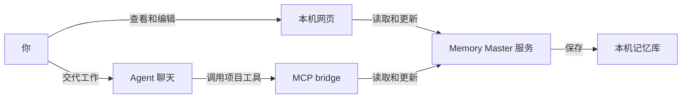

<p align="center">
  
</p>

<h1 align="center">Memory Master</h1>

<p align="center"><strong>让人和多个 AI Agent 接着推进同一个项目。</strong></p>
<p align="center">在网页查看进展，在熟悉的 Agent 聊天中工作，共用保存在本机的项目记录。</p>
<p align="center">简体中文 · <a href="README.en.md">English</a></p>

Memory Master 是一个本地项目管理与交接工具。它保存项目背景、长期约定、目标、当前进展、任务和资料，让你在换一个聊天或换一个 Agent 后，仍能找到工作停在哪里、下一步做什么。

你可以用它管理软件开发，也可以管理学习计划、活动筹备、创作或调研。每个项目有独立的记忆目录，可以按需关联工作文件夹。

[快速开始](#快速开始) · [连接-agent](#连接-agent) · [日常使用](#日常使用) · [数据保存](#数据保存) · [本地开发](#本地开发)

## 主要功能

| 能力 | 你可以做什么 |
| --- | --- |
| 多项目记忆库 | 在一个本机网页里建立、切换和管理多个项目，分别保存项目记录。 |
| 项目概览 | 先看最新进展、当前目标和重点任务，按需展开完整简介、项目约定、功能与用法和关键路径。 |
| Agent 接手 | 在聊天中指定项目，让 Agent 读取共享记录，接着推进并保存结果。 |
| 目标与阶段进展 | 独立管理目标，保留已完成和已调整目标的原文与日期，记录和修正关键阶段成果。 |
| 任务管理 | 跟踪任务状态，网页展示当前重点 P0，Agent 可维护后续安排 P1。 |
| 项目架构 | 用关系图、各部分职责和主要流程说明项目，支持 Markdown 编辑与预览。 |
| 项目资料 | 上传原件，在网页阅读 Markdown 和文本，下载其他格式，供 Agent 按需读取。 |
| 版本与变更记录 | 修改时校验读取版本，冲突时返回最新内容，成功保存后记录操作者、时间与前后值。 |
| 客户端授权 | 分别启用或关闭各个 Agent 客户端的记忆库访问，启用时自动安装连接配置与协作 Skill。 |

## 快速开始

以下步骤从当前仓库源码运行。准备 Git 和 Bun 1.4.4；开发与发布工具的 Node.js 要求为 26.12.1 或更高，详见开发文档。[查看开发环境说明](DEVELOPMENT.md)

```bash
git clone https://github.com/Wylam-Yun/memory-master.git
cd memory-master
bun install
bun src/cli.ts serve
```

终端会打印网页地址，默认是 `http://127.0.0.1:6420`。端口被占用时会选择后续可用端口，以实际输出为准。若网页没有自动打开，将该地址粘贴到浏览器。

1. 首次进入时选择记忆库目录，默认建议 `~/Documents/MemoryMaster`。
2. 在「所有项目」点击「＋ 新建项目」，输入名称。需要时展开「关联本地文件夹（可选）」，填写已有文件夹的绝对路径。
3. 在概览填写项目简介和当前进展，或按下一节连接 Agent 后，在聊天中让它整理。
4. 打开「设置」，启用你准备使用的 Agent 客户端。

服务运行期间保持终端进程开启。关闭网页后服务继续运行，在终端按 `Ctrl+C` 可停止服务。

也可以指定端口并自行打开网页。

```bash
bun src/cli.ts serve --port 6430 --no-open
```

构建后可通过独立可执行文件启动。

```bash
bun run build
./dist/memaster serve
```

> [!NOTE]
> 本文描述当前主干源码的功能。项目仍在开发中，macOS 安装应用属于后续交付计划。

## 连接 Agent

Memory Master 通过 MCP（Model Context Protocol，让 Agent 调用外部工具的协议）向聊天中的 Agent 提供项目读写工具。服务端保存记录，客户端通过 `bridge` 连接本机服务。



### 在设置中启用

1. 启动服务，打开网页「设置」。
2. 找到已安装的客户端，打开访问开关。系统会写入 MCP 配置、协作指令和 `memory-master` Skill，并保留配置中已有的其他内容。
3. 在对应客户端开启新会话或重新加载 MCP 连接。
4. 等待设置页从「已配置，等待接入」变为「已接入」，再在聊天中指定项目。

当前提供以下客户端的配置安装与独立授权。

| 客户端 | `connect` 参数 |
| --- | --- |
| Codex | `codex` |
| Claude Code | `claude-code` |
| Devin | `devin` |
| Cursor | `cursor` |
| OpenCode | `opencode` |
| Hermes | `hermes` |
| DeepSeek Harness | `dsh` |

「已接入」表示该客户端的桥接进程曾成功联系服务。关闭某个客户端的开关后，服务会拒绝它后续的项目读写请求。

需要手动配置时，先在设置中启用客户端，再在仓库目录运行相应命令，取得该客户端格式的配置片段。

```bash
bun src/cli.ts connect codex
bun src/cli.ts connect claude-code
```

输出包含本机服务地址和访问凭据，请将它用于对应客户端的本地配置。

### 在聊天中建立或选择项目

连接 Agent 后，可以直接在聊天中建立项目。

> 帮我在 Memory Master 建立一个「订单系统」项目，关联本地目录 `/Users/我的用户名/workspace/orders`，根据我们刚才确认的需求整理项目简介和下一步任务。

Agent 会先查找相关项目。发现可能是同一项工作的项目时，它会在当前聊天说明候选名称和相关内容，询问你要更新已有项目还是新建。你选定后，它才保存记录。你也可以主动要求它查询。

> 我们刚才讨论的科幻读书会，记忆库里有没有相关项目？如果有，先告诉我为什么相关，问我是否更新进去。

查询会匹配项目名称、概览正文和明确提供的关联目录，返回最多 20 个候选摘要。Agent 根据聊天上下文判断内容是否相关，措辞差异较大时可以更换关键词或查看项目列表。创建成功后项目会出现在网页，已打开的网页会定期刷新项目列表，切回网页也会刷新。

### 在聊天中继续项目

先在网页建立一个名为「读书会」的项目，然后可以这样交代工作。

> 打开 Memory Master 的「读书会」项目。先读当前进展、项目约定和相关任务，告诉我停在哪里，然后继续准备下次活动需要的阅读材料。

换一个 Agent 或开启新聊天后，继续指定同一个项目。

> 接手「读书会」项目，根据共享记录继续下一步。完成后更新任务和当前进展，写清已经完成的结果、剩余工作和下一步。

安装的协作 Skill 规定 Agent 先读取记录，再按实际结果维护进度。涉及需要你决定的选择时，在原聊天中讨论，并把确认结论保存到项目记录。接手效果取决于客户端是否加载了连接、指令和 Skill，以及记录是否及时维护。

### 关联已有本地项目

新建项目时可以填写已有文件夹的绝对路径。项目已经建立后，在概览的项目名称下查看「本地文件夹」，点击「关联本地文件夹」或「修改关联」，填写完整路径后保存。清空输入再保存可解除关联。项目移动后，在这里保存新路径。

也可以在聊天中说“把订单系统项目关联到 `/Users/我的用户名/workspace/orders`”。Agent 会读取最新配置，再保存你指定的目录。关联目录会告诉 Agent 到哪里读取工作文件，项目记录保存在记忆库目录。Agent 读取工作文件仍取决于对应客户端的文件访问权限。

升级后需要重启服务，在设置中重新启用相应客户端以安装新版协作指令和 Skill，并重连 MCP 或开启新聊天，才能使用新增工具。

## 日常使用

### 查看当前情况与长期约定

打开项目后，概览优先展示最新进展、当前目标和当前任务。点任务名称可进入任务页并定位相应条目，点「查看全部任务」进入任务管理。

「完整简介」保存项目背景。「项目约定」保存已确认、以后仍需遵守的决定与限制。「关键路径」记录关键数据、测试文件或材料的位置，便于下一位 Agent 找到继续工作所需的内容。每一栏都可以在概览内阅读和编辑。

### 管理目标和阶段成果

在「当前目标」点击「管理目标」添加一句话目标。目标达成后归档为已完成，方向变化时调整并保留原目标。需要你认可结果的目标，可以勾选「完成前需要我确认」。

关键成果完成后，在「阶段成果」记录标题、日期和结果说明。历史目标与阶段成果按需展开，支持修正记录；日期无法确认时可以标为未知。

### 阅读项目架构和资料

从侧栏进入「项目架构」，按整体说明、关系图、各部分职责和主要流程阅读。点击图节点可以定位对应职责，选择「编辑」可修改 Markdown 并查看预览。

从「资料」上传项目原件，单个文件上限为 10 MiB。点击文件名可阅读 Markdown 或文本，其他格式可下载原件。Agent 可以读取同一份已上传资料。[查看详细操作](docs/USER-GUIDE.md)

### 查看修改与处理冲突

「变更记录」显示谁在什么时候改了哪些内容，展开可查看前后值。多人或多个 Agent 修改同一条记录时，过期版本会被拒绝；重新读取最新内容，比较差异后再保存。

## 数据保存

记忆库目录与工作文件夹分别保存。以名为 `reading-club` 的项目目录为例，主要文件如下。

```text
~/Documents/MemoryMaster/
└── reading-club/
    ├── memaster/
    │   ├── config.yml        # 项目身份、名称和可选工作文件夹
    │   ├── overview.md       # 简介、约定、当前进展、目标、成果与用法
    │   ├── architecture.md   # 保存后生成的项目架构
    │   ├── tasks/            # Markdown 任务文件
    │   └── changelog.jsonl    # 自动生成的变更记录
    └── 资料/                  # 用户上传的原件
```

应用设置默认保存在 `~/.memory-master/settings.json`，包含记忆库位置、服务端口与客户端授权信息。备份项目时保存记忆库目录，妥善保管含访问凭据的应用设置文件。

网页与 MCP 使用同一份记录。更新项目内容请通过对应入口保存，以便保留版本校验与自动历史。服务监听 `127.0.0.1`，网页和 Agent 的项目访问都依赖本机服务运行。

## 仓库内的任务管理

项目还提供 `memaster` CLI、终端看板和仓库内网页看板，适合把任务、文档和决策记录与代码放在一起。以下命令假设你已构建项目，并将生成的可执行文件加入 `PATH`。

```bash
# 在需要管理的项目目录中初始化
memaster init "My Project" --defaults

# 创建和查看任务，默认 ID 前缀为 TASK
memaster task create "准备发布说明"
memaster task list --plain
memaster task view TASK-1 --plain

# 打开终端看板或当前目录项目的网页看板
memaster board
memaster browser

# 搜索任务、文档和决策
memaster search "发布" --plain
```

`memaster serve` 打开多项目记忆库，`memaster browser` 打开当前目录项目的任务看板。仓库任务模式也支持里程碑、依赖、验收项、任务归档与恢复，以及用于脚本的 JSON 输出。初始化普通本地文件项目时可添加 `--no-git`。

仓库模式的 Agent 连接入口是 `memaster mcp start`，共享记忆库使用 `memaster bridge`，由设置页安装客户端配置。[CLI 参考](CLI-INSTRUCTIONS.md) · [高级配置](ADVANCED-CONFIG.md) · [Shell 补全](completions/README.md)

## 本地开发

主要实现使用 TypeScript、Bun 和 React。以下目录分别负责命令、共享服务、网页和 Agent 连接。

| 位置 | 职责 |
| --- | --- |
| `src/cli.ts` | `serve`、`connect`、`bridge` 与仓库任务命令入口。 |
| `src/library/` | 项目存储、概览、目标、资料、版本、历史与客户端配置安装。 |
| `src/library-web/` | 多项目记忆库的 React 网页。 |
| `src/mcp/library-bridge.ts` | 将共享记忆库工具连接到 MCP 客户端。 |
| `src/library/agent-content/` | 随客户端安装的协作 Skill 与内容标准。 |
| `src/core/`、`src/server/`、`src/web/` | 仓库任务管理、任务看板服务和网页。 |
| `src/test/` | 自动化测试。 |

```bash
bun run check:types
bun run check
bun run test
bun run build
```

环境设置、构建与 MCP 调试见开发文档，项目操作见用户指南。[开发说明](DEVELOPMENT.md) · [用户指南](docs/USER-GUIDE.md)

Memory Master 基于 Backlog.md 演进，原有版权信息保留在许可文件中。[项目许可](LICENSE)
