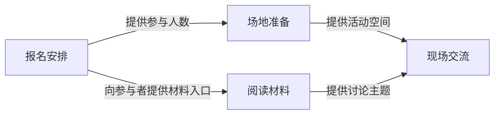

# 项目架构的记录格式

项目架构保存为一份 Markdown，包含 Mermaid 图源、组成说明和核对信息。软件渲染为项目架构页，Agent 读取同一份源内容。适用于活动流程、内容结构、学习安排、分工关系等用途，无需源码或工作目录。内部文件与工具沿用 `architecture` 名称。

## 必须表达的内容

- 标题和一句话说明，帮助人理解覆盖范围。
- 核对时间和本次核对范围，注明信息来自用户确认、选入的资料或实际工作结果。尚属计划的内容明确标注为计划。
- 按项目主要组成、流程或分工组织总图。节点 ID 使用稳定标识，显示名称使用普通用户能理解的项目语言。箭头标签解释具体关系。
- 组成表包含稳定 ID、名称和说明，可选来源及关联任务 ID。关联关系以此表为来源，任务可独立于结构存在。需要确认的组成用待确认标识表达。
- 关键关系与已确认的项目信息对应。内部可维护来源供后续核对，普通进度更新无需 Agent 额外填写原因或证据链接。
- 本次仍缺的信息。与任务关联时使用项目中已存在的任务 ID。

## 图示规则

Mermaid 使用静态流程图或时序图。总图先覆盖主要关系，复杂部分展开为细图。统一字体层级，标签优先使用完整项目用语，单个标签过长时调整划分或换行。颜色配合文字区分职责和对象。用户阅读图和文字即可，无需学习图源语法。

可使用 SVG 输出作为应用预览，由应用的受控渲染器生成。持久化内容保留可编辑图源。应用使用本地打包的渲染依赖、严格的 Mermaid 安全配置和完整文字布局。

## 示例

以下仅为格式演示，实际保存时使用当前项目的信息及任务 ID。

````markdown
# 周末读书会项目架构

围绕已确认的读书会，组织报名、场地、阅读材料和现场交流。以下关系表示用户已确认的筹备计划，任务完成情况由任务记录维护。

核对时间：2026-11-05  
信息来源：用户确认的活动安排、项目资料中的阅读清单  
核对范围：筹备计划和分工。活动尚未举办。

## 组成关系



## 组成说明

| 组成 ID | 名称 | 说明 | 来源（可选） |
| --- | --- | --- | --- |
| signup | 报名安排 | 明确参与者与人数，整理活动通知 | 用户确认的活动安排 |
| venue | 场地准备 | 根据人数确认空间与时间 | 用户确认的活动安排 |
| reading_materials | 阅读材料 | 提供章节和讨论问题 | 项目资料中的阅读清单 |
| event | 现场交流 | 按已确认安排开展讨论 | 用户确认的活动安排 |

## 关键关系说明

- 报名人数用于场地安排，来自用户已确认的筹备顺序。
- 阅读清单中的讨论问题用于现场交流，来自已选入的阅读清单。

## 待确认

- 场地最终地点等待用户确认；确认后更新相应说明。
````

## 交付检查

逐个确认图节点与组成表对应，每条关系与已确认的项目信息一致。可选来源存在时核对其可用性。查看预览时确认全部标签可读，图源仍可编辑。局部更新保留未涉及组成的稳定 ID 和已有说明。无工作目录也能保存、读取及展示结构图；无结构图时其余项目管理功能照常使用。

## 专项扩展

用户明确需要软件架构图时，可用 [专项 Skill 草案](ARCHITECTURE-SKILL.md) 补充源码位置、模块职责和实际调用依据。它们属于该专项用途，不是通用结构记录的必填项。已有专项记录继续可读，解析兼容原有模块表，不因格式泛化丢失内容。
