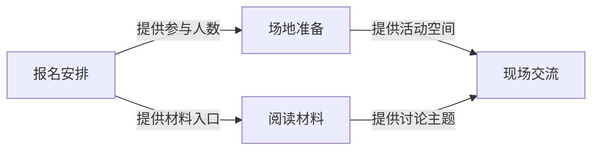

# 项目架构的记录格式

项目架构保存为一份 Markdown，包含关系图、各部分职责和主要流程。软件将组成表在原位置显示为说明列表，Agent 读取同一份源内容。适用于活动流程、内容结构、学习安排、分工关系等用途，无需源码或工作目录。内部文件与工具沿用 `architecture` 名称。

## 阅读顺序与内容

1. 标题与整体说明：用一小段话说明主要有哪些部分、怎样共同工作。
2. 组成关系：提供总图，节点名称使用普通用户能理解的项目语言；箭头解释具体动作。
3. 各部分做什么：用组成表维护稳定 ID、名称和自然语言职责。每个节点的说明应当独立可懂，不依赖用户先读聊天。网页默认展示名称及职责，不再同时展示原始表格或额外重复列表。
4. 主要流程：用简短段落或步骤说明这些部分如何衔接。不要再重复所有节点职责。

来源和已有任务 ID 是可选补充，网页按需展开；不强制用户填写。只有有助于理解真实性和范围时，才简短说明来源、核对时间或范围。计划中的组成明确标为计划，尚不确定的关系只在相关位置说明缺少什么，并在聊天中询问用户。

本轮测试是否通过、Agent 是否接手、还有哪些发布工作等内容属于当前进展和任务，不写入架构。不生成固定的「本轮验证」「待办清单」或空白待确认章节。普通更新不要求额外填写原因和证据链接。

## 图示与组成表规则

Mermaid 使用静态流程图或时序图。总图覆盖主要关系，复杂部分再展开为细图。节点 ID 使用稳定标识，显示名称使用项目语言，长标签通过划分或换行保证可读。箭头标明「提供人数」「读取资料」「更新进展」等具体动作。

组成表至少包含「名称」「说明」列，建议包含「组成 ID」以对应图节点；可选「来源」「关联任务」列。图节点与组成表 ID 一一对应，局部更新不随意改 ID。关联任务只使用项目中已存在的 ID；网页补充信息只显示其中的 P0 任务。

网页用组成表替换为一份说明列表，保留前后正文及其它表格；没有组成表的自由格式记录仍完整显示。编辑预览与阅读页面一致，源表仍可编辑。点击总图节点可以定位并短暂突出相应说明，默认阅读不依赖节点点击。

持久化内容保留可编辑图源。应用使用本地打包的渲染依赖、严格的 Mermaid 安全配置和完整文字布局，不要求用户学习图源语法。

## 示例

以下仅为格式演示，实际保存时使用当前项目的信息。

````markdown
# 周末读书会项目架构

读书会由报名安排、场地准备、阅读材料和现场交流四部分组成。以下是用户已确认的筹备计划。

## 组成关系



## 各部分做什么

| 组成 ID | 名称 | 说明 |
| --- | --- | --- |
| signup | 报名安排 | 收集参与者的报名信息，确认人数，并发送活动通知。 |
| venue | 场地准备 | 根据报名人数安排合适的活动空间，确认使用时间。 |
| reading_materials | 阅读材料 | 为参与者提供要阅读的章节和讨论问题，帮助大家提前准备。 |
| event | 现场交流 | 按约定的主题组织讨论，让参与者交流阅读收获。 |

## 主要流程

1. 收集报名信息，按人数安排场地。
2. 向参与者发送阅读材料和活动通知。
3. 在约定时间开展交流，围绕准备好的问题讨论。
````

## 维护与交付检查

主要组成、职责、关系或流程发生变化时更新。逐个确认图节点与组成表对应，每条关系与已确认信息一致。检查各部分职责没有在表外重复，工作进度没有混入架构。可选来源存在时核对其可用性。可用预览工具时确认全部标签可读；无法检查视觉效果时在当前对话或进展中明确说明范围，不塞入架构正文。

已有记录只修改本次涉及的内容，不为统一样式丢掉用户正文。无工作目录也能保存和读取架构；无架构时其余项目管理功能照常使用。

## 专项扩展

用户明确需要软件架构图时，可用 [专项 Skill 草案](ARCHITECTURE-SKILL.md) 补充源码位置、模块职责和实际调用依据。这些是专项用途的可选内容，不是通用架构的必填项。已有专项记录继续可读，兼容原有模块表。
